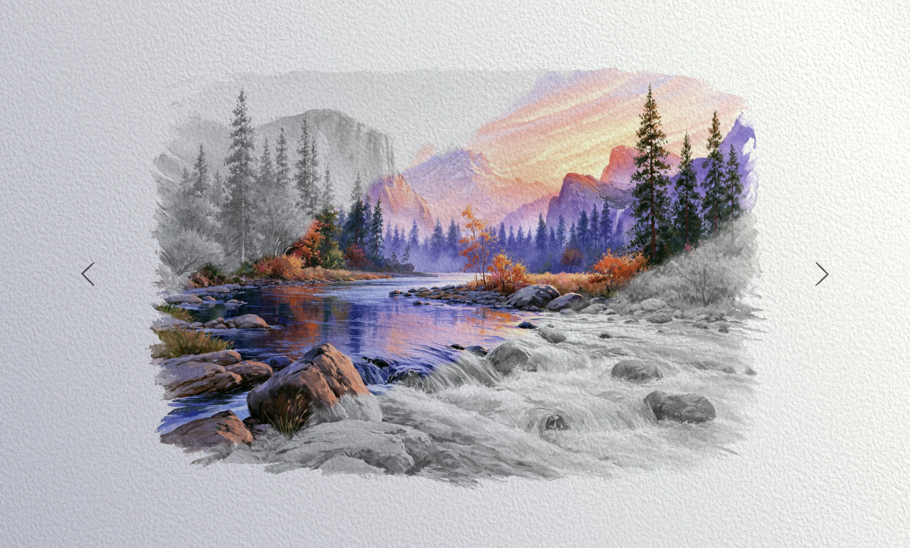

# Watercolor Reveal Effect

Interactive Three.js demo: watercolor paintings sit on procedural paper in greyscale, and the cursor floods colour back in with a bleeding, drying wash. Inspired by [Yuri Artiukh’s recreation](https://www.youtube.com/live/ggruH0fHPOM) of the [14islands](https://www.14islands.com/) footer; paper shading adapted from [watercolor-playground](https://github.com/msurguy/watercolor-playground).



## Features

- Procedural cold-press paper with height field, lighting, and pigment response
- Cursor-driven reveal mask: flood, bleed falloff, and drying at a fixed 60 steps/sec
- Gallery of paintings with prev/next dissolve transitions
- lil-gui debug folders for image and reveal params (add `#debug` to the URL; also on by default on localhost)

## Setup

Requires [Node.js](https://nodejs.org/en/download/) and [pnpm](https://pnpm.io/).

```bash
# Install dependencies (first time only)
pnpm i

# Dev server at localhost:5173
pnpm dev

# Production build → dist/
pnpm build
```

## Imagery Credits

Paintings generated with Midjourney. Shadow overlays from [Resource Boy](https://resourceboy.com/textures/shadow-overlays/).
